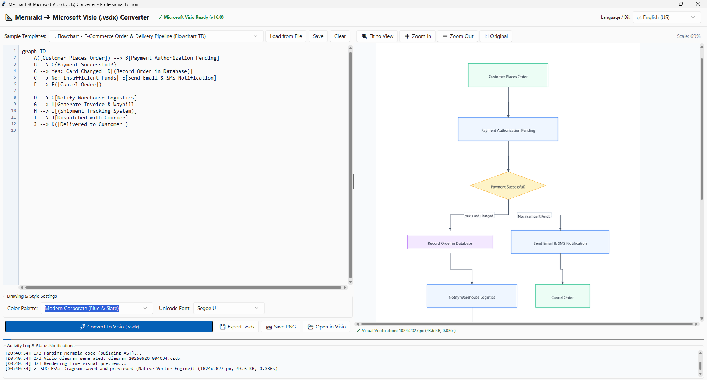
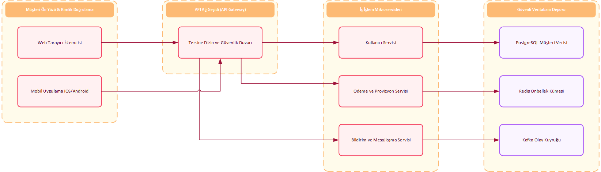
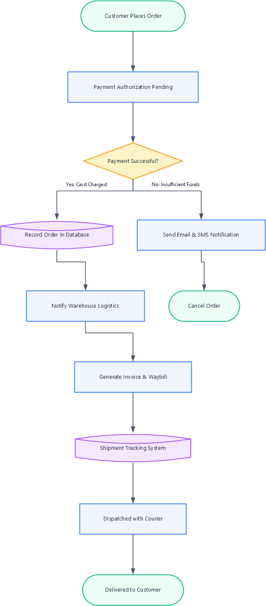
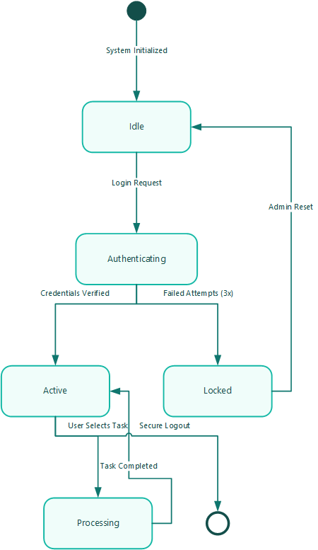

# Mermaid to Microsoft Visio (.vsdx) Converter
### Enterprise-Grade Native Headless Compiler & Desktop Application

[](https://www.python.org/downloads/)
[](LICENSE)
[]()

A robust, enterprise-grade tool that converts **11 Mermaid diagram types** (**Flowcharts**, **Sequence Diagrams**, **UML Class Diagrams**, **Entity-Relationship Diagrams**, **State Machines**, **Block Diagrams**, **Mindmaps**, **Timelines**, **Quadrant Charts**, **Pie / Donut Charts**, and **Gantt Charts**) — plus **Multi-Page Markdown Documents** — into professional, executive-ready **Microsoft Visio (`.vsdx`)** vector drawings with **100% Turkish character fidelity**, automated visual verification screenshots, and dynamic orthogonal connector routing.

Featuring a **Dual-Engine Architecture**:
1. **Native Headless OPC Compiler Engine (`--engine native`, Default)**: Pure Python implementation that builds standard Open Packaging Conventions `.vsdx` ZIP packages directly without requiring Microsoft Visio or Windows COM Interop. Runs cross-platform on Windows, Linux, macOS, and in CI/CD containers.
2. **Visio COM Automation Engine (`--engine com`)**: Direct automation of Microsoft Visio Desktop on Windows via `win32com.client` for interactive canvas manipulation and high-DPI verification screenshots (`--verify`).

<p align="center">
  
</p>

---

## 📸 Visual Showcase & Generated Visio Drawings

Every diagram below is natively compiled into a real Microsoft Visio (`.vsdx`) drawing with parametric vector shapes, orthogonal dynamic connectors, and crisp Unicode typography:

| Microservices Architecture (Subgraphs) | E-Commerce Workflow (Flowchart) |
| :---: | :---: |
|  |  |

<p align="center">
  <b>State Machine & Authentication Lifecycle</b><br/>
  
</p>

---

## 🔌 Automation & Skill Integration (`SKILL.md`)

This repository is equipped with a skill specification ([`SKILL.md`](SKILL.md)) for automated workflow runners and command-line automation.

The complete instructions and protocol are available in:
- **Root Specification**: [`SKILL.md`](SKILL.md)
- **Modular Skill Folder**: [`skills/mermaid-to-visio/SKILL.md`](skills/mermaid-to-visio/SKILL.md)

### Key Capabilities:
1. **Autonomous Diagram Ingestion**: Extract single or multiple ```` ```mermaid ```` code blocks directly from markdown documentation into single-page or multi-page `.vsdx` archives.
2. **Zero-Dependency Headless Compilation**: Run `--engine native` in any cloud container, Linux server, or local environment without Microsoft Office.
3. **Automated Visual Verification Loop**: When Visio is present, invoke `--verify` to render a 300-DPI PNG screenshot into `verification_output/` and inspect layout accuracy using image inspection tools before completing tasks.
4. **Professional Themes & Fonts**: Select appropriate palettes (`Modern Corporate`, `Emerald Tech`, `Sunset Coral`, `Minimalist Slate`, `Grayscale Clean`) and TrueType fonts (`Segoe UI`, `Calibri`, `Arial`).

```powershell
# Global CLI command (works anywhere after pip install)
mermaid-to-vsdx diagram.mmd -o output/diagram.vsdx --engine native --palette "Modern Corporate (Blue & Slate)"

# With visual verification (Windows + Visio)
mermaid-to-vsdx diagram.mmd -o output/diagram.vsdx --verify

# Or from cloned repository root:
python main.py diagram.mmd -o output/diagram.vsdx --verify
```

---

## 🌟 Key Features

1. **Enterprise Headless `.vsdx` Compiler (Zero Visio Required)**:
   - **Open Packaging Conventions (OPC)**: Directly builds valid ZIP container packages (`[Content_Types].xml`, `_rels/.rels`, `docProps/`, `visio/document.xml` with standard StyleSheets and registered `<FaceNames>`, `windows.xml`, and single or multi-page `pages/page1..N.xml`).
   - **Calibrated Text Metrics**: Headless typographical layout estimating text bounds for Latin and Turkish character classes, proportional font scaling, HTML/Markdown formatting cleanup, and multi-line wrapping.
   - **Sugiyama Hierarchical Layout**: Deterministic graph layout engine with cycle removal, longest-path & source-tightened rank assignment, leaf-subgraph peer unification, parent-child chain alignment, corridor-aligned skip-level waypoints, cross-subgraph corridor clearance, and coordinate inversion.
   - **Parametric ShapeSheet XML**: 14 standard node geometry primitives (rectangles, rounded, stadiums, diamonds, cylinders, subroutines, hexagons, parallelograms, trapezoids, circles, double circles) with evaluated physical coordinates, dynamic formulas, and subtle card elevation shadows (`ShdwPattern=1`).
   - **Dynamic Glue Topologies**: Generates page-level `<Connects>` records and distributed connection points (`Bottom_0`, `Top_in_0`, etc.) binding connectors to shapes for dynamic re-routing.

2. **Robust Mermaid AST Parser, 11 Diagram Types & Multi-Page Markdown Ingestion**:
   - **Multi-Page Markdown Document Ingestion**: Seamlessly reads `.md` and `.markdown` files. If a Markdown document contains multiple ```` ```mermaid ```` blocks, compiles each diagram onto its own named Visio page tab (`Page-1`, `Page-2`, etc. using preceding Markdown headings) inside a single `.vsdx` archive.
   - **Flowcharts (`flowchart`, `graph`)**: Supports directions (`TD`, `TB`, `LR`, `RL`, `BT`), all 14 standard shapes plus Mermaid v11 `@{ shape: ... }` syntax (`rect`, `rounded`, `stadium`, `subroutine`, `cyl`, `circle`, `dbl-circ`, `odd`, `diamond`, `hex`, `lean-r`, `lean-l`, `trap-b`, `trap-t`), custom styling (`classDef`, `class`, `:::className`, `style`, `linkStyle`), extended connectors (`-->`, `---`, `-.->`, `==>`, `<-->`, `--o`, `--x`, `--->`, `~~~`), `&` multi-target chaining, and nested `subgraph` containers.
   - **Sequence Diagrams (`sequenceDiagram`)**: Supports `participant`, `actor` (with stick-figure icons), `box` participant grouping, `autonumber`, activation bars (`+`/`-`), `loop`/`alt`/`opt`/`par`/`critical`/`break` frames with `else`/`and` dashed dividers, and `Note over`/`Note left of`/`Note right of`.
   - **UML Class Diagrams (`classDiagram`)**: Multi-compartment class shapes (header, `<<interface>>`/`<<abstract>>`/`<<enumeration>>`/`<<service>>` stereotypes, attributes, methods), visibility markers (`+`, `-`, `#`, `~`), hierarchical inheritance layout, and 8 UML relationship connectors (`<|--`, `<|..`, `*--`, `o--`, `-->`, `..>`, `--`, `..`) with shared port distribution.
   - **State Diagrams (`stateDiagram`, `stateDiagram-v2`)**: Initial state disc `[*]`, terminal bullseye `[*]`, composite/nested states (`state Parent { ... }`), `<<choice>>`, `<<fork>>`, `<<join>>`, `note left/right of`, and exterior U-channel feedback loop routing.
   - **Entity-Relationship Diagrams (`erDiagram`)**: Multi-compartment entity tables with `PK`, `FK`, `UK` badges, entity aliases (`CUSTOMER["Customer Account"]`), and true **Information Engineering Crow's Foot** cardinality markers (`||`, `|o`, `}|`, `}o`).
   - **Block Diagrams (`block-beta`, `block`)**: Multi-column grid layout (`columns N`), column spans (`:2`), nested composite blocks, `classDef`/`style` customization, and dynamic `<Connects>` glue.
   - **Mindmaps (`mindmap`)**: Radial/bilateral tree layout with root node, color-coded branch families, and hierarchical child cards.
   - **Timelines (`timeline`)**: Chronological horizontal milestone axis with color-coded `section` bands, period badges, and vertical event cards.
   - **Quadrant Charts (`quadrantChart`)**: 2x2 executive strategic matrix with tinted quadrant cards, directional X/Y axes, and collision-free data point pins + pill badges.
   - **Pie & Donut Charts (`pie`)**: True parametric `EllipticalArcTo` circular sector wedges (`showData` support), donut hole center, percentage badges, and executive legend card.
   - **Gantt Charts (`gantt`)**: Project schedule matrix with date/week column headers, section bands, status-styled task bars (`done`, `active`, `crit`), and diamond `milestone` markers.
   - **Precise Error Diagnostics**: Reports exact line numbers and code snippets on malformed syntax, highlighting the error directly in the editor.

3. **100% Turkish Character Support**:
   - Impeccable handling of all Turkish lowercase and uppercase characters: **`ç, ğ, ı, ö, ş, ü, İ, Ç, Ğ, Ö, Ş, Ü`**.
   - UTF-8 normalization (NFC) across input reading, AST generation, and Visio COM string marshaling.
   - Explicitly assigns Unicode TrueType fonts (**`Segoe UI`**, **`Calibri`**, **`Arial`**) at the ShapeSheet level to guarantee no glyph fallback, broken question marks (`?`), or empty square boxes (`□`).

4. **Visual Verification & High-Resolution Screenshot Capture**:
   - When running on Windows with Visio installed, verify generated `.vsdx` files by triggering a layout pass and exporting the canvas to a high-DPI PNG image (`Page.Export()`).
   - Automatically saves timestamped verification images in `verification_output/`.
   - Validates image dimensions, file size, and render performance using Pillow.

5. **Modern Windows 11 Desktop GUI**:
   - Dual-pane layout: Monospace Mermaid code editor with synchronized line numbers on the left, interactive zoomable/pannable verification screenshot preview on the right.
   - Preset selector with 13 rich templates covering all 11 Mermaid diagram types.
   - Direct file loading for `.mmd`, `.txt`, `.md`, and `.markdown`.
   - Customizable color palettes (`Modern Corporate`, `Emerald Tech`, `Sunset Coral`, `Minimalist Slate`, `Grayscale Clean`) and Unicode fonts.
   - Real-time logging console and progress indicator.
   - "Open in Visio" button to inspect the generated `.vsdx` in Microsoft Visio with a single click.
   - Fluent theme integration (`sv-ttk`) with Dark and Light mode toggle.

---

## 📋 System Requirements

- **Operating System**: Windows 10/11, Linux, or macOS (Headless Native OPC Engine); Windows 10/11 for Visio COM Verification
- **Python**: Python 3.10 or newer
- **Microsoft Visio** *(Optional, for `--engine com` or `--verify`)*: Visio 2016, Visio 2019, Visio 2021, or Microsoft 365 Visio

---

## 🚀 Quick Start

> **Prerequisites**: Python 3.10 or newer (`python --version`). Compatible with Windows, macOS, and Linux (Native OPC Engine).

### Option A: Install Globally via Pip (Recommended for Automation & CLI)

Install directly from GitHub to get the universal `mermaid-to-vsdx` command in your environment:

```powershell
pip install git+https://github.com/enginciftci/mermaid-to-vsdx.git
```

Now you can convert diagrams from **any directory**:
```powershell
mermaid-to-vsdx diagram.mmd -o output/diagram.vsdx
```

### Option B: Clone Repository & Run Desktop Application / CLI

Clone the repository and install dependencies:

```powershell
git clone https://github.com/enginciftci/mermaid-to-vsdx.git
cd mermaid-to-vsdx
python -m pip install -r requirements.txt
```

Launch the Windows 11 Fluent Desktop GUI:
```powershell
python main.py
# or double-click run.bat
```

Dependencies in `requirements.txt`:
- `pywin32>=306`: Microsoft Visio COM automation interface (Windows).
- `pillow>=10.0.0`: Image processing and high-resolution preview canvas.
- `sv-ttk>=2.6.0`: Modern Windows 11 Fluent theme for Tkinter.

---

## 🖥️ Using the Desktop GUI

1. **Select a Preset or Enter Mermaid Code**:
   - Use the **"Sample Presets"** dropdown to load any of the 13 built-in templates across all 11 diagram types.
   - Or paste your own Mermaid diagram syntax directly into the code editor.
2. **Configure Styling**:
   - **Color Palette**: Select from *Modern Corporate (Blue & Slate)*, *Emerald Tech (Mint & Teal)*, *Sunset Coral & Violet*, *Minimalist Slate (Dark / Steel)*, or *Grayscale Clean (Black & White)*.
   - **Unicode Font**: Choose *Segoe UI* (recommended), *Calibri*, or *Arial*.
3. **Generate & Verify**:
   - Click **"🚀 Convert to Visio (.vsdx)"**.
   - The app parses the AST, applies dynamic layout, connector routing, saves the `.vsdx` into `output/`, and exports a high-resolution screenshot into `verification_output/`.
4. **Interactive Preview**:
   - The right panel displays the verified rendering immediately.
   - Use **Zoom In (+)**, **Zoom Out (-)**, **Fit to Window (Fit)**, or drag with the mouse to pan across large diagrams.
5. **Open in Visio**:
   - Click **"📂 Open in Visio"** to launch the file directly in Microsoft Visio with one click.

---

## 💻 Headless CLI Mode

The converter can be run headlessly from the command line for automated workflows, build pipelines, or CI/CD tasks:

```powershell
# Convert a Mermaid file (.mmd or .txt) to Visio with automatic visual verification
mermaid-to-vsdx input_diagram.mmd -o output/diagram.vsdx --verify

# Extract single or multiple Mermaid blocks from a Markdown document (.md) into a single/multi-page .vsdx
mermaid-to-vsdx documentation.md -o output/architecture.vsdx --verify

# Black & White / Grayscale publication theme
mermaid-to-vsdx input_diagram.mmd -o output/diagram.vsdx --palette "Grayscale Clean (Black & White)" --verify

# Choose a specific palette and font
mermaid-to-vsdx input_diagram.mmd -o output/diagram.vsdx --palette "Emerald Tech (Mint & Teal)" --font "Calibri" --verify

# Specify a custom screenshot output path
mermaid-to-vsdx input_diagram.mmd -o output/diagram.vsdx --screenshot verification_output/my_diagram.png
```

### CLI Arguments:

| Argument | Description | Default |
| :--- | :--- | :--- |
| `input` / `-i` | Path to the input `.mmd`, `.txt`, `.md`, or `.markdown` file. If omitted, GUI opens. | Optional |
| `-o, --output` | Destination `.vsdx` file path. | `<input_basename>.vsdx` |
| `--engine` | Engine type: `native` (pure Python headless OPC compiler, zero Visio required) or `com` (Visio COM automation). | `native` |
| `-p, --palette` | Theme: `Modern Corporate (Blue & Slate)`, `Emerald Tech (Mint & Teal)`, `Sunset Coral & Violet`, `Minimalist Slate (Dark / Steel)`, `Grayscale Clean (Black & White)`. | `Modern Corporate` |
| `-f, --font` | Unicode-safe font family: `Segoe UI`, `Calibri`, `Arial`. | `Segoe UI` |
| `--verify` | Triggers Visio canvas export and verification screenshot (requires Visio on Windows). | `False` |
| `-s, --screenshot` | Explicit file path for the verification screenshot PNG. | Auto timestamped |
| `--verification-dir` | Output folder for verification screenshots. | `verification_output` |

---

## 🏗 Architecture & Code Structure

```text
mermaid-to-vsdx/
├── src/mermaid_to_vsdx/
│   ├── compiler/                 # 100% Headless Native .vsdx Compiler (Pure Python)
│   │   ├── __init__.py           # Compiler facade (compile_mermaid_to_vsdx + multi-page Markdown)
│   │   ├── text_metrics.py       # Typographical layout & character sizing heuristics
│   │   ├── layout_engine.py      # Sugiyama hierarchical layout & coordinate transforms
│   │   ├── shapesheet.py         # Visio ShapeSheet XML templates, Crow's Foot & 14 vector primitives
│   │   ├── opc_package.py        # Single & Multi-Page Open Packaging Conventions (OPC) ZIP builder
│   │   ├── flowchart_compiler.py # Flowchart, v11 shapes, classDef/linkStyle & subgraph compilation
│   │   ├── sequence_compiler.py  # Sequence lifelines, actors, boxes, alt/else/loop & notes
│   │   ├── class_compiler.py     # Multi-compartment UML class diagram compilation
│   │   ├── state_compiler.py     # State machines, composite states, notes & U-channel loops
│   │   ├── er_compiler.py        # ER entity tables & Information Engineering Crow's Foot markers
│   │   ├── block_compiler.py     # Block-beta multi-column grid, composite blocks & <Connects>
│   │   ├── mindmap_compiler.py   # Radial/bilateral Mindmap layout & branch family styling
│   │   ├── timeline_compiler.py  # Chronological Timeline spine, section bands & event cards
│   │   ├── quadrant_compiler.py  # 2x2 Strategic Quadrant Matrix, axes & collision-free badges
│   │   ├── pie_compiler.py       # Parametric EllipticalArcTo Pie/Donut wedges & legend card
│   │   └── gantt_compiler.py     # Project Gantt schedule grid, task bars & milestone diamonds
│   │
│   ├── parser/
│   │   ├── __init__.py           # Unified parser interface (11 diagram types + Markdown extractors)
│   │   ├── ast_nodes.py          # Dataclass models for all 11 Mermaid diagram ASTs
│   │   ├── base_parser.py        # Tokenizer, multi-block Markdown extractor & MermaidParseError
│   │   ├── flowchart_parser.py   # Flowchart parser (14 shapes, v11 @{shape}, classDef/style/linkStyle)
│   │   ├── sequence_parser.py    # Sequence parser (participants, actors, boxes, autonumber, alt/else)
│   │   ├── class_parser.py       # UML Class parser (compartments, stereotypes, relationships)
│   │   ├── state_parser.py       # State parser (composite states, choice/fork/join, notes)
│   │   ├── er_parser.py          # ER parser (entities, aliases, PK/FK/UK, cardinalities)
│   │   ├── block_parser.py       # Block parser (columns, spans, nested blocks, classDef/style)
│   │   ├── mindmap_parser.py     # Indentation-hierarchy Mindmap parser
│   │   ├── timeline_parser.py    # Timeline sections, periods & events parser
│   │   ├── quadrant_parser.py    # Quadrant chart axes, quadrants & [x, y] points parser
│   │   ├── pie_parser.py         # Pie chart showData, title & slices parser
│   │   └── gantt_parser.py       # Gantt chart sections, dates, durations & dependencies parser
│   │
│   ├── visio/                    # Desktop Visio COM Automation Engine & Themes
│   │   ├── __init__.py           # Converter facade (convert_mermaid_to_visio)
│   │   ├── com_client.py         # VisioSession STA manager, C2R launch & lifecycle
│   │   ├── palettes.py           # 5 executive color themes (Corporate, Emerald, Coral, Slate, Grayscale)
│   │   └── shapes.py             # Visio COM shape geometry, text centering, font assignment
│   │
│   ├── verifier/
│   │   ├── __init__.py
│   │   ├── native_renderer.py    # Pure-Python Pillow vector-to-raster .vsdx PNG renderer
│   │   └── screenshot.py         # Visio Page.Export high-DPI canvas capture & Pillow check
│   │
│   ├── gui/
│   │   ├── __init__.py
│   │   ├── app_window.py         # Windows 11 Fluent GUI application
│   │   ├── code_editor.py        # Editor widget with line numbers & error markers
│   │   ├── image_preview.py      # Interactive zoom/pan verification preview canvas
│   │   └── samples.py            # 13 rich Mermaid diagram presets across all 11 diagram types
│   │
│   └── utils/
│       ├── __init__.py
│       └── unicode_helper.py     # Turkish char analysis, NFC normalization, HTML/Markdown cleaning
│
├── assets/                       # High-resolution showcase diagram screenshots
├── skills/                       # Modular skill package
│   └── mermaid-to-visio/
│       └── SKILL.md
├── tests/                        # Comprehensive unit & visual quality test suite (28 tests)
├── main.py                       # Application entrypoint (GUI + CLI)
├── SKILL.md                      # Automation skill specification
├── LICENSE                       # MIT License
└── README.md                     # Documentation
```

---

## 🛡️ Error Handling & Troubleshooting

- **Running Without Microsoft Visio**: Use `--engine native` (the default). It uses pure Python to build the `.vsdx` file and does not require Microsoft Office or Windows COM Interop.
- **"Microsoft Visio Bulunamadı" (When using `--engine com` or `--verify`)**: Ensure Microsoft Visio is installed on the machine. The application checks Windows Registry CLSIDs (`Visio.Application` / `Visio.InvisibleApp`) and standard Office 16 Program Files directories.
- **Malformed Mermaid Syntax**: The editor highlights the faulty line with an indicator and reports the specific syntax issue.
- **COM Apartment Issues**: All COM calls run within Python Single-Threaded Apartments (`pythoncom.CoInitialize()` / `CoUninitialize()`), ensuring thread safety and preventing UI freezing.

---

## 📄 License & Trademark Notice

Distributed under the **MIT License**. See [`LICENSE`](LICENSE) for more information.

### Trademark Notice
- Microsoft, Microsoft Visio, and Windows are registered trademarks or trademarks of Microsoft Corporation in the United States and/or other countries.
- Mermaid is a trademark/open-source project created by Knut Sveidqvist and contributors.
- This project is an independent open-source tool and is not affiliated with, endorsed by, sponsored by, or associated with Microsoft Corporation or Mermaid.
